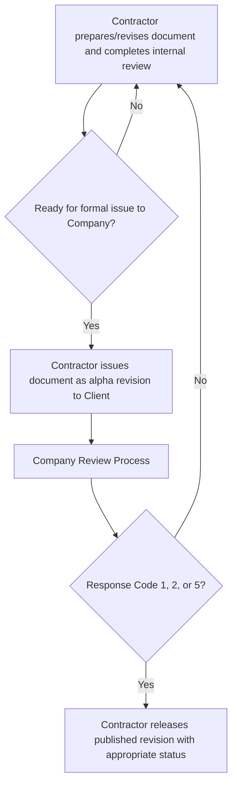

> [!warning] Official documentation overrides anything within this document
> This document is meant to be a guide. Links to the source document are provided and should always be used to authenticate the accuracy of this document's content. 

## Definitions

- Client -  The owner of the project
- Company - Hanson Professional Services, Inc.

## Client

### Resources

- [Aconex](https://us1.aconex.com/hub/index.html)
- [ExxonMobil SharePoint](https://spsharing1.exxonmobil.com/sites/NAE/Hanson/Shared%20Documents/Forms/AllItems.aspx)

#### Information Management Specification

> [!info] Definition of **Company**
> Client uses the term **Company** within documentation; this is referencing the Client, not contractors.

- [USCP-0000-EM-JA-SPC-120115 - Information Management (Documents and Data) Specification](https://hansonprosvc.sharepoint.com/:b:/r/sites/PRJ-24I0048/Documents/USCP-0000-EM-JA-SPC-120115.pdf)
- USCP-0000-EM-AA-SPC-0001 - Project General Instructions and Information (GII) (*not yet transmitted*)

##### Client Document Numbering

A document number is a unique identifier (think Social Security Number). Every piece of a document number excluding the sequence provides crucial metadata as identified below.

See [USCP-0000-EM-JA-SPC-120115](https://hansonprosvc.sharepoint.com/:b:/r/sites/PRJ-24I0048/Documents/USCP-0000-EM-JA-SPC-120115.pdf), section 6.1 *Document Numbering*

$$ \text{AABB - CCUU - DD - EE - FFF - zzz - xxx} $$

- **AA** - Country Code per ISO 3166-1 (See [USCP-0000-EM-JA-SPC-120115](https://hansonprosvc.sharepoint.com/:b:/r/sites/PRJ-24I0048/Documents/USCP-0000-EM-JA-SPC-120115.pdf), Table 1)
- **BB** - Company Facility (See See [USCP-0000-EM-JA-SPC-120115](https://hansonprosvc.sharepoint.com/:b:/r/sites/PRJ-24I0048/Documents/USCP-0000-EM-JA-SPC-120115.pdf), Table 1)
- **CC** - Area Code (See [USCP-0000-EM-JA-120115-302](https://hansonprosvc.sharepoint.com/:x:/r/sites/PRJ-24I0048/Documents/USCP-0000-EM-JA-SPC-120115-302.xlsx?d=wf78004b8dc3f47c1972fecd8af4d47d9&csf=1&web=1&e=KvYQF9))
- **UU** - Unit Code (See [USCP-0000-EM-JA-120115-303](https://hansonprosvc.sharepoint.com/:x:/r/sites/PRJ-24I0048/Documents/USCP-0000-EM-JA-SPC-120115-303.xlsx?d=wc3605465ce204e16b19e8c4d81a33c26&csf=1&web=1&e=U0rlFQ))
- **DD** - Originator Company (See [USCP-0000-EM-JA-120115-310](https://hansonprosvc.sharepoint.com/:x:/r/sites/PRJ-24I0048/Documents/USCP-0000-EM-JA-SPC-120115-310.xlsx?d=w4b9d345d5cf24f459f3e4c2efa183226&csf=1&web=1&e=Ap6Mr7))
- **EE** - Discipline Code (See [USCP-0000-EM-JA-120115-201](https://hansonprosvc.sharepoint.com/:x:/r/sites/PRJ-24I0048/Documents/USCP-0000-EM-JA-SPC-120115-201.xlsx?d=w448b9d6f8868496e9b219c399d85b7b9&csf=1&web=1&e=Nd58Zd))
- **FFF** - Document Type Code (See [USCP-0000-EM-JA-120115-202](https://hansonprosvc.sharepoint.com/:x:/r/sites/PRJ-24I0048/Documents/USCP-0000-EM-JA-SPC-120115-202.xlsx?d=wae3c9fbfa6f444bf9cc8cb98d688eb79&csf=1&web=1&e=ugcj5H))

##### Document Revisions

###### Revision Numbering

Generally speaking, prior to approval a document shall have an alpha revision (i.e., "A", "B", ...). After approval, revision numbering is numeric (i.e., "0", "1", "2", ...). The structure of the revision number may vary by project and you are encouraged to reference official documentation identified below. 

See [USCP-0000-EM-JA-SPC-120115](https://hansonprosvc.sharepoint.com/:b:/r/sites/PRJ-24I0048/Documents/USCP-0000-EM-JA-SPC-120115.pdf), section 8.2.2.. *Revision Identifiers*

###### Revision Status

Revision status is the issue purpose of the document; i.e., Issued for Information (IFI), Issued for Review (IFR), Issued for Void (IFV), etc.

See [USCP-0000-EM-JA-SPC-120115](https://hansonprosvc.sharepoint.com/:b:/r/sites/PRJ-24I0048/Documents/USCP-0000-EM-JA-SPC-120115.pdf), Table 5. 8.2.1., *Revision Status*

> [!note]
> A document may have a Revision Status of PLN (Planned), DFT (Draft), or CAN (Cancelled) based on Company specifications. 
> - PLN: A document is planned but is not yet under development. 
> - DFT: A planned document is under development but yet to be officially reviewed. 
> - CAN: A planned document is no longer needed and has not undergone an official review process. These document numbers, as with Void documents, may not be used for other documentation.

##### Review Categories

See [USCP-0000-EM-JA-SPC-120115](https://hansonprosvc.sharepoint.com/:b:/r/sites/PRJ-24I0048/Documents/USCP-0000-EM-JA-SPC-120115.pdf), Section 8.3.1., *Review Categories and Review Timeframe*, Table 6.

- **Category I**: 15 working days
- **Category II**: 10 working days. Client response required. 
- **Category III**: 10 working days. Response failure shall be considered Code 1 Approved. 
- **Category IV**: Not applicable

##### Response Codes

See [USCP-0000-EM-JA-SPC-120115](https://hansonprosvc.sharepoint.com/:b:/r/sites/PRJ-24I0048/Documents/USCP-0000-EM-JA-SPC-120115.pdf), Section 8.3.3., *Company Response Codes*

- **Code 1**: Reviewed with no comments. Reissue without change at next applicable revision.
- **Code 2**: Reviewed with minor comments. Revise and reissue at next applicable revision.
- **Code 3**: Reviewed with major comments. Revise and reissue at next alpha revision.
- **Code 4**: Not accepted. Alignment meeting between Company/Client before proceeding. Resubmit at next alpha revision.
- **Code 5**: Information only

##### Document Review Process

##### Void and Superseded

Generally, a document is Void only after it has gone through at least one review process and the technical content is no longer applicable or has been included in another document. Once a document is Void the number shall never be issued or used again.

See [USCP-0000-EM-JA-SPC-120115](https://hansonprosvc.sharepoint.com/:b:/r/sites/PRJ-24I0048/Documents/USCP-0000-EM-JA-SPC-120115.pdf), Section 8.7., Voided and Superseded Documents

- Issue at Revision "X", Issued for Void.
- If a superseding document exists, 
	- On Void document:
		- Revision Description: "Issued for Void - Superseded by [Document Number]"
		- Title: "[Document Title] - SUPERSEDED BY [Document Number]"
	- On Superseding document:
		- Revision Description: "[Revision Status]. Supersedes [Document Number]"

### Master Document Register (MDR)

A Master Document Register template has been supplied under [USCP-0000-EM-JA-SPC-120115-006]([USCP-0000-EM-JA-SPC-120115-006.xlsx](https://hansonprosvc.sharepoint.com/:x:/r/sites/PRJ-24I0048/Documents/USCP-0000-EM-JA-SPC-120115-006.xlsx?d=wbdd8f7b520f945ea95a17b6a8255879a&csf=1&web=1&e=PYZAE2). The official MDR shall be issued under a separate document number. More information on the MDR may be found in  [USCP-0000-EM-JA-SPC-120115](https://hansonprosvc.sharepoint.com/:b:/r/sites/PRJ-24I0048/Documents/USCP-0000-EM-JA-SPC-120115.pdf), Section 7., *Document Attributes and the Master Document Register*.

| Attribute Name                                  | Mandatory | Optional | Valued Provided By                                            |
| ----------------------------------------------- | --------- | -------- | ------------------------------------------------------------- |
| Document Category Name                          | x         |          | Company</style> |
| Document Number                                 | x         |          | Client</style>    |
| Document Revision Identifier                    | x         |          | Company</style> |
| Document title                                  | x         |          | Company</style> |
| Document Status Code                            | x         |          | Company</style> |
| Discipline Name                                 | x         |          | Company</style> |
| Document Type Group Name                        | x         |          | Company</style> |
| Document Type Name                              | x         |          | Company</style> |
| Document Revision Date                          | x         |          | Company</style> |
| Document Originator Company Code                | x         |          | Client</style>    |
| Originator Document Number                      | x         |          | Company</style> |
| Originator Document Revision Identifier         | x         |          | Company</style> |
| Project ID                                      |           | x        | Company</style> |
| Project Phase Name                              |           | x        | Company</style> |
| Contract Number                                 | x         |          | Company</style> |
| Contractor Name                                 | x         |          | Company</style> |
| Facility Code                                   | x         |          | Company</style> |
| Area Code                                       | x         |          | Company</style> |
| Unit Code                                       | x         |          | Company</style> |
| Tag Number                                      |           | x        | Company</style> |
| Commissioning System Number                     |           | x        | Company</style> |
| Purchase Order Number                           |           |          | Company</style> |
| Supplier Name                                   |           |          | Company</style> |
| Review Category Code                            | x         |          | Company</style> |
| Company Response Code                           | x         |          | Client</style>    |
| Document Has Holds Indicator                    | x         |          | Client</style>    |
| Document Revision Comments                      | x         |          | Client</style>    |
| Language Code                                   |           | x        | Company</style> |
| MPI Classification Name                         |           | x        | Company</style> |
| Confidential Indicator                          |           | x        | Company</style> |
| Export Control Classification Code              |           | x        | Company</style> |
| OIMS Classification Name                        |           | x        | Company</style> |
| Retention Code                                  |           | x        | Client</style>    |
| Required Document Status For The Handover Event |           | x        | Company</style> |
| Start-Up Critical Indicator                     |           | x        | Company</style> |
| Forecast Review Date                            | x         |          | Company</style> |
| Actual Review Date                              |           | x        | Company</style> |
| Forecast Issued for Design Date                 |           | x        | Company</style> |
| Actual Issued for Design Date                   |           | x        | Company</style> |
| Forecast Issued for Construction Date           |           | x        | Company</style> |
| Actual Issued for Construction Date             |           | x        | Company</style> |
| Forecast Issued As-Built Date                   | x         |          | Company</style> |
| Actual Issued As-Built Date                     |           | x        | Company</style> |

## Company

### Resources

- [Hanson InfoServ](https://hansonprosvc.sharepoint.com/Pages/default.aspx)
	- CORP1300, *Records Management Manual*
	- QUAL4000, *Quality Manual*
	- [Quality Assurance](https://hansonprosvc.sharepoint.com/empres/qa/Pages/default.aspx)
		- [Quality Assurance Documents](https://hansonprosvc.sharepoint.com/hansondocs/Pages/Quality Assurance/QualityAssuranceDocs.aspx)
			- **3000 - Procedure**
				- [QUAL3090 - Preparation & Review of Technical Calculations](https://hansonprosvc.sharepoint.com/hansondocs/Quality Assurance/Procedures - 3000/QUAL3090.docx)
				- [QUAL3092 - Preparation & Review of Technical Documents](https://hansonprosvc.sharepoint.com/hansondocs/Quality Assurance/Procedures - 3000/QUAL3092.docx)
				- [[QUAL3130 - Control of Project Records]]
			- **Forms**
				- [QUAL3090.01/QUAL3092.01 - Review of Technical Calculations/Technical Documents](https://hansonprosvc.sharepoint.com/hansondocs/Quality Assurance/Procedures - 3000/QUAL3090.01_QUAL3092.01.aspx)
- [PRJ-24I0048 - SharePoint](https://hansonprosvc.sharepoint.com/sites/PRJ-24I0048/default.aspx)
	- [Libraries > Documents](https://hansonprosvc.sharepoint.com/sites/PRJ-24I0048/Documents/Forms/AllItems.aspx)
	- [Templates](https://hansonprosvc.sharepoint.com/sites/PRJ-24I0048/Templates/Forms/AllItems.aspx)
- [24I0048_00 - I-Drive](I:\24jobs\24I0048_00\Admin)
	- [Data Warehouse](I:\24jobs\24I0048_00\Admin\00-Project Records\24I0048_00 - Data Warehouse.xlsx)

## NDAs
- I:\Master Agreements\5 NON-DISCLOSURE AGREEMENTS (NDA)\Industry\ExxonMobil Chemical Major Growth Ventures LLC\NDA Acknowledgement Forms for 24I0048 Series\NDAAcknowledgementTracker_24I0048_Series.xlsx
